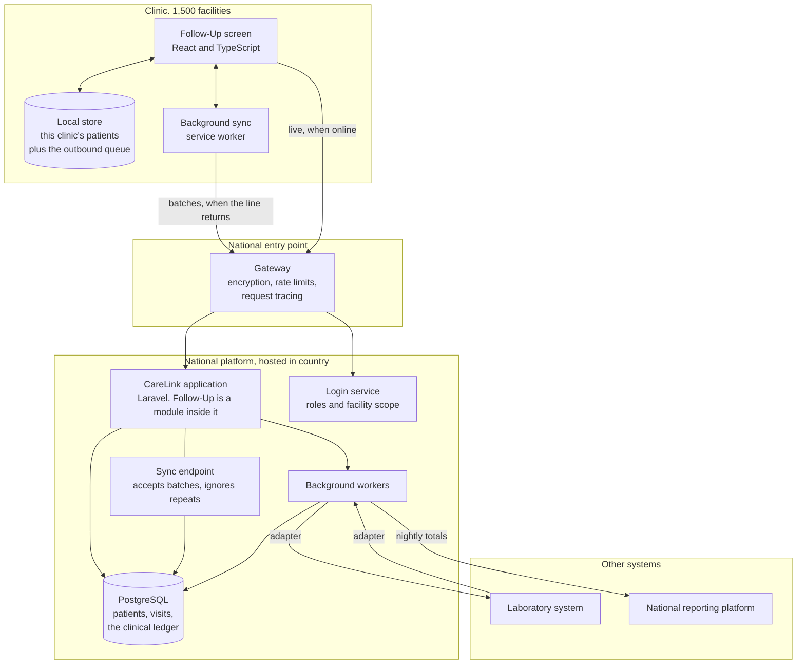

# A. Architecture and Trade-offs

**CareLink Follow-Up module**
Candidate: Daniel Ng`andu. Position: Manager SI, Software Engineering.

---

## 0. What I assumed

* CareLink already has a login system and a patient register. Follow-Up uses both rather than building its own.
* A facility owns its patients. A patient belongs to one facility at a time. Moving a patient to another facility is a recorded event, not a quiet edit.
* The 300 facilities that are offline for days have power and a working computer. They are not a different product. They just sync less often.
* Nine months gets the first facilities live, not all 1,500. I have planned a phased rollout.

---

## 1. The design in plain terms

A clinic has a computer. Staff open CareLink Follow-Up in a browser. That browser holds a copy of that clinic's own patients, so the screen still works when the line is down. Anything staff record is written on that computer first and put in a queue. When the connection returns, the queue empties to the national server.

That is the whole design. Everything below is detail.

**How the pieces talk.** The clinic computer only ever talks to the gateway, over an encrypted connection. There are two ways it talks. Live question and answer when the network is up, and batches drained in the background when it comes back. The application talks to its own database directly. It talks to the laboratory system and the reporting platform only through background workers, never while a clinic is waiting for a screen to load. No clinic should ever wait on the laboratory system to see a list of patients.

**Why one application and not many small services.** Follow-Up is a module inside the existing CareLink application. It has its own tables, its own migrations and a clear boundary in the code, but it ships as one thing. Nine people, nine months, and a Ministry that has to run this long after the project money ends. Splitting it into separate services would buy scaling we do not need at 3,000 users and would cost us an operations burden the team cannot carry.

---

## 2. What data lives where

**Held nationally.** Patient identity and details, the facility register, user accounts and roles, the clinical ledger, and the follow-up lists worked out from it.

**Held at the clinic.** A working set, not a copy of the country. On each sync the computer takes that facility's active patients, their visits from the last twelve months, the current follow-up list, and the facility's own reference data. A clinic with 10,000 people on its follow-up list is holding tens of megabytes, not a national database.

**How the two settle up.** This is the decision the whole design rests on.

Most systems store a patient as a row and update it. If two people change the same row, the last change wins and the earlier one quietly disappears. For a phone number that is acceptable. For a clinical record it is not, because nobody finds out until it matters.

So clinical facts are written down as separate entries in a ledger that is only ever added to, which engineers will know as an append-only event log. A visit recorded offline is a new entry with its own reference number. A contact attempt is a new entry. Entries are only ever added, so two clinics, or one clinic sending the same queue twice, can never wipe out each other's record. The follow-up list is then worked out from that ledger, which means it can always be rebuilt and is never the thing we are protecting.

Fields that genuinely have one right answer, like a phone number or a corrected date of birth, do use last change wins, by the time the server received it. The old value stays in the ledger, so nothing is actually lost.

When an entry arrives and cannot be applied, because the patient was merged or moved or the date is impossible, it does not get thrown away and it does not get forced through. It goes into a list the facility administrator can see, and a person decides. Quiet data loss is what destroys trust in a national system, so I would rather have a visible pile of awkward cases.

---

## 3. The API, and how the other systems connect

**Shape.** Plain REST over JSON, with a version in the address. Every list is filtered, paged and sorted by the server, not by the browser. Errors always come back in the same shape, with a code the software can act on, a message a person can read, and a tracing reference. Errors never leak anything about what is happening inside.

**Sync.** One address that takes a batch of entries from a clinic and answers for each entry separately. Every entry carries a reference number the clinic computer generated before sending. That number is also what stops duplicates. If the connection drops and the whole batch is sent again, the server sees reference numbers it already has and does nothing. Same idea as a receipt number. Some entries succeeding and others failing is normal and is reported entry by entry.

**The laboratory system.** A translator sits at the boundary, running in the background. Results either get pushed to us, or we go and fetch them on a schedule where the lab cannot push. Both routes end up at the same translator, which converts the lab's format into our ledger entries. At that boundary I would use HL7 FHIR, specifically the DiagnosticReport and Observation resources, so the contract between us is a recognised standard rather than something the two teams invented between themselves. Our own internal model stays plain. If the lab cannot speak FHIR today, the translator absorbs that, and nothing has to change in our system when they can.

**The reporting platform.** Totals, sent on a schedule, not a live feed of every event. A nightly job works out each indicator for each facility for each period and sends it keyed on facility, period and indicator. Run it twice and it overwrites rather than double counts. Individual patient records do not leave CareLink for the reporting platform.

---

## 4. Who can see and do what

**When online.** Staff log in against the CareLink login service. They get a short lived pass, good for fifteen minutes, that carries their role and which facility they belong to, plus a longer lived renewal tied to that computer.

| Group | Can see | Can do |
|---|---|---|
| Clinician | Their own facility | Read and record patients, visits and contact attempts |
| Facility administrator | Their own facility | Everything a clinician can, plus local users and the awkward cases list |
| District officer | Facilities in their district | Read only, including patient names |
| National user | All facilities | Totals. Patient names only for a stated reason, which is recorded |
| National data steward | All facilities | Everything a national user can, plus correcting facility records that have already synced, for maintenance |

The brief named four groups. I have added a fifth, the national data steward, because someone at national level has to be able to repair records after they arrive. Merged patients, a facility that synced under the wrong code, a batch that landed with a bad date. Without that role the only ways to fix national data are to ask the clinic to redo work it has already done, or to let engineers edit the database by hand, and the second one is how national systems quietly lose their audit trail.

The role is deliberately narrow. A steward corrects records, they do not create clinical facts. Every correction is a new entry in the ledger carrying the steward's name, the reason and what it replaced, so nothing is overwritten and the original stays readable. The facility sees the correction on its next sync, on the same awkward cases list the facility administrator already uses, so a clinic is never silently overruled from Lusaka. Access is granted to named individuals, not to a team account, and I would review that list quarterly.

Permissions are checked by the server on every single request, worked out from the pass, never from something the browser claims. The browser hides buttons people cannot use, but that is a courtesy, not security.

**When the clinic is offline.** Staff still need to get in, and that must not become a hole in the system.

At the last successful online login, the computer keeps a locked record of who you are and what you may do, signed by the server, plus a scrambled version of your PIN. The scrambled version checks your PIN locally. It is never sent anywhere.

How long that works for is set per facility, not by one national number, because some facilities are unreachable for months at a time. The default is 30 days. Facilities known to be hard to reach are marked as such and issued a credential lasting 180 days. The clock resets on any contact with the server, so a facility that syncs once a quarter never comes near its limit.

When a credential does approach expiry, the screen warns the clinic two weeks ahead, and it can be renewed without a network. The district office reads out a short signed code over the phone, or carries it on a USB stick on the next supervision visit. The system never locks a clinic out of its own patient records because head office could not be reached. Recording clinical work is a duty, not a privilege the network grants.

The cost of this is worth stating plainly. A laptop lost from a remote facility carries a longer lived credential than one lost in Lusaka. That is why the local store is encrypted, why it holds only the working set and no national identifiers, and why a reported device is wiped the next time it connects.

The central server holds the active user list, so removing a user at district or facility level takes effect at the clinic only once that change reaches it. It is applied after the next full sync, the queue going up and the refreshed user list coming down. Until that happens the account still opens the application on that computer.

That gap is managed outside the software, and the design should say so rather than pretend otherwise. Where a user is removed while their facility is offline, the facility administrator restricts physical access to the machine, or issues an alternative account and the old one stops being used. The system supports that. It cannot enforce it.

What the server does enforce is the record. Every offline action carries the user and the computer that made it, and is checked again when it arrives. Work recorded by an account that had been withdrawn is not accepted quietly. It goes to the awkward cases list for a person to decide. Offline login is a convenience. The server remains the authority on what counts.

The 30 day and 180 day figures are my judgement and I would expect the Ministry to set them, with the list of hard to reach facilities maintained provincially and reviewed each year. They are settings, not numbers buried in the code.

---

## 5. What the clinic sees when it is offline for days

* The application opens with no network at all, because the browser already holds it.
* The patient list comes from the local store. A quiet banner always sits at the top saying something like, working offline, last updated Tuesday 09:14. How old the data is should always be visible, never guessed at.
* New visits and contact attempts are saved on that computer and added to the queue. Staff are told plainly that the record is saved here and will upload later.
* Things that genuinely need fresh data, like transferring a patient to another facility or searching nationally, are switched off with a plain explanation. They do not sit there and fail quietly.
* When the line comes back, the queue is sent in order, in small batches, slowing down and spacing out its attempts if the connection is poor. An entry only leaves the queue once the server has confirmed it.
* How much is kept locally is capped, at a budget of 500 MB per computer, so that a computer left offline for years does not fill its own disk. Unsent work is never part of what gets evicted.

That 500 MB splits into 200 MB for the working set, which may be evicted because the server still holds it, and 300 MB reserved for the outbound queue, which is never evicted. At roughly 2 KB an entry, 300 MB holds well over 100,000 unsent entries. A busy facility recording 250 visits a day would need more than a year offline to reach it.

The rule is that unsent work is never deleted to make room. What happens instead is that the system gets louder. At 60 percent of the queue budget the screen warns staff. At 80 percent the facility appears on the national list of clinics in trouble, so somebody is dispatched rather than waiting for the clinic to call. At 90 percent staff are told to export the queue to a USB stick for the district office.

Exporting does not by itself free space. A queue entry is released only once it has been confirmed accepted, exactly as it is online. The USB copy is a backup until the district office imports it and the return file comes back carrying the acknowledgements. Only then does the clinic computer clear those entries. Treating the export itself as a handover would mean a lost or corrupted stick takes clinical records with it.

If the queue does fill despite all of that, the application stops accepting new records and tells staff to go to paper, in those words, on screen. It does not delete anything and it does not carry on pretending to save work it cannot keep. Existing patient data stays readable, so staff can still look things up while they write on paper, and the paper is back entered once the queue drains. This should effectively never happen, because the budget holds more than a year of a busy facility's work, so reaching it means the warnings at 60 and 80 percent went unanswered for weeks. At that point the failure is as much in supervision as in the software, and the fix belongs in both.

This matters most in the case nobody plans for, which is a bad release that breaks syncing and leaves a high volume facility stranded for weeks. That is precisely when quietly dropping the oldest records would do the most damage, and it is why the queue has a reserved share of the budget rather than competing with cached patient data for space.

A facility that is offline more or less permanently needs saying out loud, because escalation that travels over the network cannot reach it. Two things change for those sites. The alarm does not come from the clinic, it comes from the national side noticing the silence, which is the first item on the watch list in section 6, and a visit is dispatched. And the USB export stops being an emergency measure and becomes that facility's normal way of syncing, on the supervision visit schedule. The queue is exported as a signed file, carried to the district office, imported there, and the return file brings back the refreshed user list and a renewed credential.

That is a courier sync measured in weeks rather than seconds. It is slow, and it is still a working system. What it does not settle is whether a browser store is the right home for months of unsent work on such a site, which is the open question in section 10. And if a facility is offline permanently and receives no supervision visits either, nothing in this document helps it. That is a paper site, and the honest answer is to say so rather than ship software that pretends otherwise.

---

## 6. What I would watch, in words a clinic would use

Underneath these sit the usual engineering numbers. Response times, error rates, queue depth. But these are the six I would put on the wall and go through every week, because a clinic manager can actually act on them.

1. **Which clinics have sent us nothing in 24 hours.** The single best warning that a site is in trouble, whether that is network, power or a broken computer.
2. **How many visits are stuck waiting to upload, by clinic.** A rising number means sync is failing, not that staff have stopped working.
3. **How long it takes to open a follow-up list**, measured on a real clinic machine, not on a developer's laptop.
4. **How many records are waiting for a person to decide.** This is where quiet data loss would otherwise hide.
5. **How many staff could not log in today.** Which separates forgotten passwords from a login outage.
6. **Whether yesterday's release made any of the above worse.** Every number tagged with the version that is running.

---

## 7. Getting it deployed

**Where.** One national environment inside the country, on government or SMART Zambia hosted infrastructure, with all patient data and all backups held in country. The design does not depend on any particular cloud. It is containers, PostgreSQL, a cache and file storage, so it runs in a government data centre or a commercial one without being redesigned. I would avoid any managed service that ties us to one supplier's way of doing things.

**How.** Built once by the pipeline and promoted through environments. Deployed a few machines at a time behind the gateway, so there is never a moment when the service is down.

A worked example. Say the Ministry adds a required referral outcome field, and we are releasing it on a Tuesday with every clinic open.

The rollout itself. The new version goes to one application server out of twelve. For twenty minutes we watch the clinic signals from section 6 on that server only, chiefly how long a follow-up list takes to open and how many requests are failing. If it holds, the rest follow in batches of three. If any batch moves those numbers, the rollout stops and the eleven servers still on the old version carry the traffic. Nobody in a clinic sees an outage, because at every moment some server is serving.

The database change, across four releases rather than one.

1. Add the referral outcome column, nullable, nothing backfilled. The new code writes it where staff supply it, and still reads the old field for everything else. Old and new code both work against this schema, which is what makes the rolling deploy safe.
2. Backfill the existing rows in batches overnight, in small chunks so no clinic meets a locked table in the morning.
3. Switch reads over to the new column once the backfill is verified. Still nothing is dropped.
4. Remove the old column in a later release, once we are confident and no client still asks for it.

The reason for four releases instead of one is the rollback. At any point in steps 1 to 3 we can put the previous version back and it still runs, because we have not yet taken anything away. A single release that renames the column leaves the old version unable to start, and the only way back is a database restore, during clinic hours, with the queue still arriving.

**Releases go out while clinics are open**, and that rules out database changes that break the running version. Every change to the database is done in two steps. Add the new structure, run a release that writes to both and still reads the old, fill in the gap, switch reading over, then remove the old structure in a later release. It is slower. It also means a clinic never sees a broken screen because of our release schedule.

**The clinic copy is versioned separately and must tolerate an older version talking to a newer server.** A clinic offline for a week will reconnect to a server that has moved on. The sync endpoint accepts the previous version. If the clinic copy genuinely cannot send what is in its queue, it keeps the queue and tells the user. It never quietly discards it.

---

## 8. The five biggest risks

| # | Risk | Why it matters | What I would do about it |
|---|---|---|---|
| 1 | **Sync loses or duplicates clinical data.** Visits recorded twice, patients created twice, records merged wrongly | A clinical record damaged this way may not be recoverable, and it is the fastest way to lose Ministry trust | Ledger that is only added to, a reference number on every entry, nothing ever dropped quietly, awkward cases decided by a person, and a restore and replay rehearsal before each release |
| 2 | **A bad release stops work mid morning** | Clinics cannot wait for a fix | Two step database changes, deploy a few machines at a time, a switch that turns the module off, release outside the morning rush, and a rollback that has been practised and does not need a database restore |
| 3 | **The screen is unusable on a 4GB machine with 10,000 rows** | Staff simply stop using it and go back to paper | Server does the filtering and paging, the screen only draws the rows in view, a hard speed budget measured on real clinic hardware, and one of those machines kept in the team room |
| 4 | **Patient data left behind on a shared clinic computer** | A legal problem and a duty of care failure | Local store encrypted, hold as little as possible, no national identifiers or clinical notes cached, capped retention, offline sessions expire, and a reported computer is wiped the next time it connects |
| 5 | **The team does not deliver in nine months.** Two seniors, five engineers, two juniors and no agreed way of working | The date is political as much as technical | Get the thinnest working path end to end into a handful of pilot clinics first, phase the rollout, pair juniors with seniors specifically on the sync code, and make scope the thing that moves rather than quality or the date |

---

## 9. The trade-offs I made

**One. One application, not many small services.**
*What I turned down:* a separate service for each area.
*Why:* separate services would let us scale and release each part on its own. We do not need that at 3,000 users, and the price is a lot of moving parts to run. Clear boundaries inside one application give us most of the benefit for a fraction of the operating cost, and we can always pull a module out later if it earns it.
*What would change my mind:* if the laboratory integration needed to scale or fail separately from patient care.

**Two. Offline in the browser, not a server in every clinic.**
*What I turned down:* a small server in each facility, copying to the national platform.
*Why:* a local server really is better for the 300 long offline sites. It survives longer, serves several computers and holds more. But it means 1,500 pieces of hardware to buy, install, patch, back up and physically fix across the country, and the capacity to do that does not exist. The browser version ships with the application and leaves nothing behind to maintain.
*What would change my mind:* evidence that long offline clinics need several computers sharing the same records during an outage, which a per browser store cannot do. I would then run the local server version for those sites only. I would much rather find that out in the pilot than guess now.

**Three. A ledger of clinical events, not rows that get overwritten.**
*What I turned down:* ordinary rows with a last updated timestamp, where the last change wins.
*Why:* last change wins is far simpler, and I would use it for a phone number. For a clinical record it destroys the losing change without telling anyone. The ledger costs more storage and some work to keep the lists up to date. In exchange, no clinical record is ever lost and every clash is visible and attributable.
*What would change my mind:* nothing, for clinical data. This is the one I would defend hardest.

**Four. Nightly totals to the reporting platform, not a live feed.**
*What I turned down:* sending every clinical event to the reporting platform as it happens.
*Why:* that platform needs periodic totals, not a live stream. A live feed would tie whether clinics can work to a system we do not control, and would push identifiable records out of CareLink for no analytical gain. A nightly send can be re-run, can be checked, and can fail without touching patient care.
*What would change my mind:* a real outbreak response need for same day surveillance data. Even then I would add a separate, narrow, totals only feed rather than streaming the clinical ledger.

---

## 10. The decision I am least sure about

Whether a browser store is enough for facilities that are offline for months rather than days. A browser's storage can be cleared by a technician, a profile reset or an aggressive cleanup tool, and the longer a clinic goes without syncing, the more unsent work sits in one place that nobody is backing up. For a site that syncs weekly I am comfortable. For a site that syncs twice a year I am not yet.

What would change my mind is the count: how many facilities genuinely go a month or more without any contact, and whether those sites run one computer or several. If that number is small, I would add a scheduled export of the queue to a USB stick, carried to the district office on supervision visits, which is a modest addition. If it is large, the browser only decision in trade-off two is the wrong one for those sites and they should run a small local server instead, with the browser version kept for the rest. I would rather settle this in the pilot than defend a guess.
